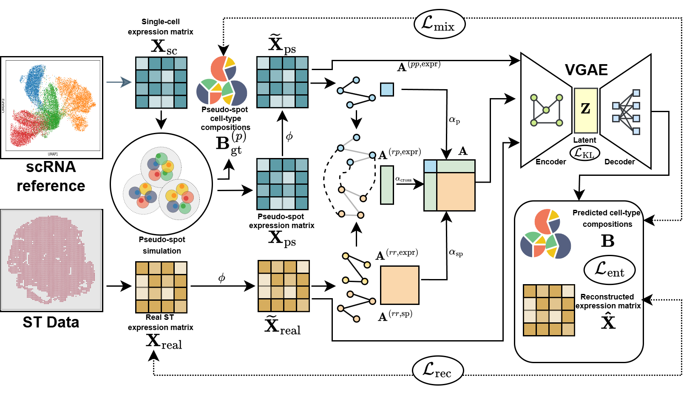

# TRACE



TRACE is a graph-based variational autoencoder for spatial transcriptomics cell-type deconvolution. It builds a sparse graph over measured spots and simulated pseudo-spots, encodes expression profiles with graph convolutions, and predicts a cell-type proportion for each spot from single-cell reference profiles.

## Repository layout

```text
TRACE/
├── configs/                 # Run configuration
├── data/SMA-ME3/            # Packaged SMA-ME3 input tables
├── docs/                    # Model diagram and data notes
├── outputs/                 # Generated run results
├── src/trace_model/         # TRACE implementation
├── pyproject.toml           # Python package and CLI entry point
└── requirements.txt         # Runtime dependencies
```

The four required SMA-ME3 inputs are stored separately as Parquet tables:

- `spot_expression.parquet`: 521 spots × 351 genes.
- `spot_coordinates.parquet`: x/y coordinates for those 521 spots.
- `cell_expression.parquet`: 11,169 reference cells × the same 351 genes.
- `celltype_labels.parquet`: one label for each reference cell.

`spot_ground_truth.parquet` is a separate optional evaluation file with proportions for 23 cell types. TRACE does not use it during fitting. The inputs contain raw counts; preprocessing performs library-size normalization and log transformation.

## Install and run

Python 3.10 or newer is recommended. Install a PyTorch build appropriate for your CPU/CUDA environment, then install the dependencies and TRACE package:

```bash
cd TRACE
python -m venv .venv
source .venv/bin/activate
python -m pip install --upgrade pip
python -m pip install -r requirements.txt
python -m pip install -e .
trace-train --config configs/config.yaml
```

TRACE automatically uses CUDA when available and otherwise runs on CPU. A short end-to-end check can be run with:

```bash
trace-train --config configs/config.yaml \
  --set n_epochs=2 \
  --set pseudo_spot_simulation_paras.spot_num=100 \
  --set progress.enabled=false
```

The default run writes predictions, metrics, the model checkpoint, selected marker genes, and plots under `outputs/SMA-ME3/seed-6077/`.

## Configuration and inputs

Edit [`configs/config.yaml`](configs/config.yaml) to set the four required input paths, optional truth path, model settings, graph settings, and output directory. TRACE accepts Parquet files only. Every expression table must be a numeric spot/cell-by-gene matrix with unique IDs and genes; the spot and reference matrices must have the same ordered genes. Coordinates must contain `x` and `y` columns and match spot IDs and order. Cell labels must contain one `cell_type` column and match reference cell IDs and order.
